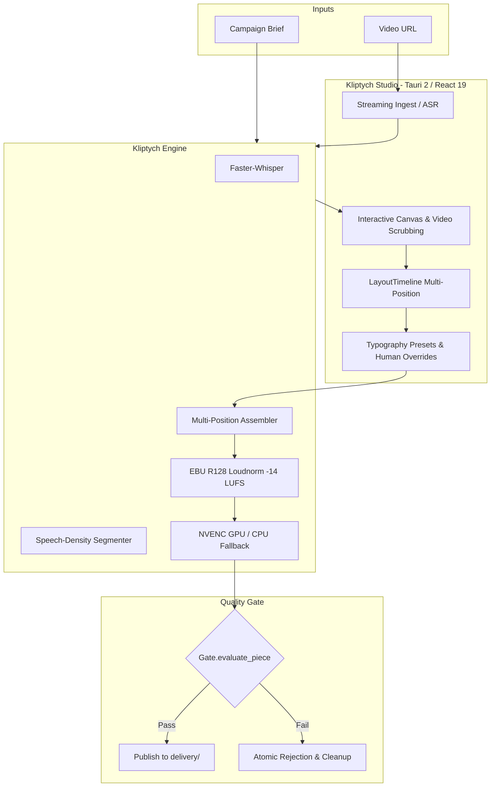

# Kliptych

Feed it a campaign brief or source URL; it delivers publication-ready vertical clips and ruthlessly blocks anything that breaks the rules.

[](https://github.com/KevinGracianoL/kliptych/actions) [](https://github.com/KevinGracianoL/kliptych/releases)  -0d9488)
    

Content Rewards and UGC campaigns only pay when every contractual rule holds:
exact brand spelling, mandatory mentions and hashtags, duration bounds, audio
requirements, watermark coverage. Human review does not scale to dozens of
cuts, and an LLM verdict is not evidence.

Kliptych converts chaotic inputs into validated vertical-video deliverables
through a versioned JSON contract, a local GPU/CPU pipeline (download, transcription,
moments, multi-band reframing, typography styling, EBU R128 loudness normalization,
hardware render), and an uncompromising fail-closed compliance gate.

What it does **NOT** do: it never auto-publishes, never lets an LLM clear a hard
rule, and never ships a partial delivery — a single rejected check aborts publication.

---

## Two Ways to Use Kliptych

### 1. Kliptych Studio (Local Desktop Editor)
A standalone, high-performance desktop application built with **Tauri 2 + React 19**:
- **Streaming Ingest (B4):** Paste a YouTube or Twitch URL; watch real-time progress (`downloading`, `transcribing`, `finding_candidates`) powered by streaming Tauri IPC channels.
- **Interactive Live Video & Scrubbing (B5):** Native zero-copy video playback with HTTP 206 partial range streaming. Instant scrubbing across 10 GB VODs with bounded memory (<150 MB).
- **Multi-Position Layout Timeline (B2.1, B3):** Cut and arrange multiple composition intervals (`Vertical`, `Dividido`, `Trío`, `Spotlight`) with free rectangular cropping over live footage.
- **Packaged Typography Presets (B2.5):** Clean, Bold, and Boxed presets using officially packaged `Noto Sans Regular` (SIL OFL 1.1) passed via `fontsdir`, with outline and shadow controls.
- **Attributed Human Caption Overrides (B2.4a):** Seamlessly correct transcript words directly in the playhead interval without losing original ASR provenance.
- **7-Zone Watermark Overlay (B2.2):** Import local PNG assets with deterministic SHA-256 binding and position snapping.
- **EBU R128 Loudness Normalization (B6):** Broadcast-standard `-14.0 LUFS` integrated loudness and `-1.0 dBTP` true peak ceiling for distortion-free playback on TikTok, Reels, and Shorts.
- **Fail-Closed Final Export (B3):** Lazy, on-demand compilation assembling multi-position cuts, native AAC audio, subtitles, and watermarks, verified by `Gate.evaluate_piece` before publishing.

### 2. Headless Python CLI (Engine & Automation)
Full programmatic pipeline for automated headless workflows, batch processing, and campaign verification:
- `kliptych analyze`: Download, transcribe, detect speech-density moments, and segment candidates without rendering video.
- `kliptych preview`: Generate exact frame snapshots and short temporal MP4 previews.
- `kliptych studio render-final`: Lazy CLI export of specific edited variants with full gate evaluation.
- `kliptych campaign`: Execute automated zero-contract or brief-driven campaigns.

---

## Quickstart

### Prerequisites
- Python 3.13+ and [`uv`](https://docs.astral.sh/uv/)
- Node.js 22+ and Rust stable (if developing or running Studio from source)
- FFmpeg installed and available on PATH

### 1. Running Kliptych Studio (Desktop)

```sh
# Clone repository
git clone https://github.com/KevinGracianoL/kliptych.git
cd kliptych

# Install dependencies
uv sync
npm --prefix studio install

# Launch desktop app in development mode
npm --prefix studio run tauri dev
```

### 2. Running Headless Python CLI

```sh
# Sync virtual environment (CUDA + MediaPipe extras optional)
uv sync
uv sync --extra transcription --extra reframe

# Check detected environment (NVENC, hardware codecs)
uv run kliptych env

# Personal zero-contract mode (automatic clipping from URL)
uv run kliptych campaign --url "https://..." --out runs/my-run/package

# Campaign brief verification with fail-closed gate
uv run kliptych ingest campaigns/fixtures/given-clips/brief.md
uv run kliptych run campaigns/fixtures/given-clips/brief.md \
  --out runs/demo-pass/package \
  --recorded campaigns/fixtures/given-clips/recorded
```

---

## Architecture & How It Works



---

## Pipeline Features & Capabilities

- **Zero-Contract Mode:** Instant clipping from a URL without requiring an LLM or campaign brief.
- **High-Retention Karaoke Subtitles:** Syllable/word SubStation Alpha (`{\k}`) tags, customizable highlight sweep color, and capitalization controls (`original`, `uppercase`, `lowercase`).
- **Typography Presets (`clean`, `bold`, `boxed`):** Packaged `NotoSans-Regular.ttf` under SIL OFL 1.1 ensuring host-independent rendering with outline and shadow parameters.
- **Multi-Band Layout Composition (`LayoutSpec`):** Normalized rectangular coordinates (`0.0`–`1.0`) with vertical stacking presets (`Dividido` 50/50, `Trío` 33/33/33, `Spotlight` asymmetric).
- **Spatially-Bounded Face Tracking:** Restricts MediaPipe face detection strictly to the streamer's camera crop, eliminating false positives from game footage and cutting CPU usage.
- **Multi-Format Aspect Ratios:** Exact integer ratios supporting TikTok/Reels (`9:16`), YouTube horizontal (`16:9`), Instagram Feed (`4:5`), and Square (`1:1`).
- **Hardware Acceleration:** Native `h264_nvenc` encoding with automatic fallback to CPU `libx264`.
- **EBU R128 Audio Loudness Normalization:** Integrated `loudnorm` filter targetting `-14.0 LUFS` and `-1.0 dBTP` ceiling for compliance across social platforms.
- **Atomic Batch Delivery & Failure Diagnostics:** 12-piece batch publishing is strictly atomic; rejections write an immediate `delivery.failure_report.json` with exact failing checks and evidence.
- **Multi-Platform Release Packaging:** Official Tauri bundler targets generating native Linux (`.deb`, `.AppImage`), Windows (`.msi`, `.exe`), and macOS (`.dmg`) installers with automated GitHub Actions releases.

---

## Why the Gate Rejects

Any single failed check rejects the piece, and anything the gate cannot mechanically prove pauses for explicit human approval instead of passing silently — see [docs/gate.md](docs/gate.md).

The gate enforces:
1. `artifact.integrity`: Artifact exists, is readable, and is not a symlink/junction.
2. `artifact.video_stream`: Artifact contains a playable video stream with matching dimensions.
3. `artifact.aspect`: Output matches declared aspect ratio (e.g., 9:16) within strict numerical tolerances.
4. `duration.min` & `duration.max`: Clip duration strictly satisfies platform or brief limits.
5. `audio.present` & `audio.silence`: Audio stream exists without accidental digital silence.

---

## Learn More

- [ADR 0001 — Track B1 Analysis CLI Contract](docs/adr/0001-track-b1-analysis-cli-contract.md)
- [ADR 0002 — Track B2 Project Timeline Contract](docs/adr/0002-track-b2-project-timeline-contract.md)
- [ADR 0003 — Track B3 Studio Final Render & Export Contract](docs/adr/0003-track-b3-studio-final-render-contract.md)
- [ADR 0004 — Track B4 Studio Ingest & Streaming Analysis Contract](docs/adr/0004-track-b4-studio-ingest-analysis-contract.md)
- [ADR 0005 — Track B5 Studio Interactive Video Playback & Scrubbing](docs/adr/0005-track-b5-studio-video-scrubbing-contract.md)
- [ADR 0006 — Track B6 Studio EBU R128 Audio Normalization Contract](docs/adr/0006-track-b6-audio-normalization-contract.md)
- [ADR 0007 — Track B7 Studio Packaging & Release Contract](docs/adr/0007-track-b7-release-packaging-contract.md)
- [Architecture — 4 Engineering Pillars](docs/architecture.md)
- [Benchmarks — GTX 1650 Ti, 4 GB VRAM](docs/benchmarks.md)
- [Gate — Fail-Closed Compliance Engine](docs/gate.md)
- [Operations — CLI 2-Step Workflow](docs/operations.md)

---

## Project Status

- **Phase A (Backend Core Engine):** 100% completed and verified (A1–A4).
- **Phase B (Kliptych Studio Desktop App):** 100% completed and verified (B1–B7).
- **Test Suite:** 2,439 tests passed, 0 failed, 90.21% test coverage across all components.
- **CI Status:** 5/5 green jobs on Ubuntu, Windows, and macOS.

---

## License

Proprietary. All rights reserved. Author: Kevin Graciano.
