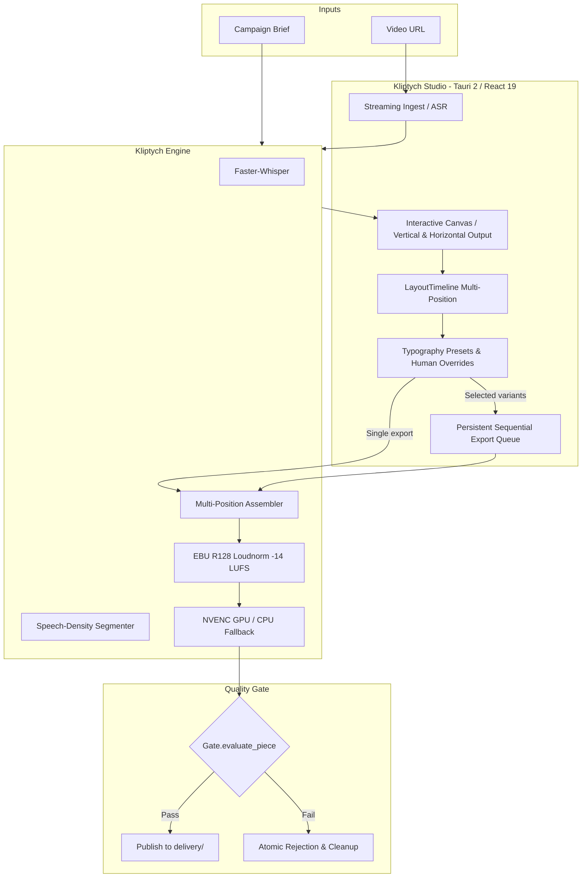

# Kliptych

Turn a source URL into editable vertical or horizontal clips, or run a campaign brief through a local, fail-closed delivery pipeline.

[](https://github.com/KevinGracianoL/kliptych/actions) [](https://github.com/KevinGracianoL/kliptych/releases)  -0d9488)
    

Content Rewards and UGC campaigns only pay when every contractual rule holds:
exact brand spelling, mandatory mentions and hashtags, duration bounds, audio
requirements, watermark coverage. Human review does not scale to dozens of
cuts, and an LLM verdict is not evidence.

Kliptych converts source media into validated video deliverables
through a versioned JSON contract, a local GPU/CPU pipeline (download, transcription,
moments, multi-band reframing, typography styling, EBU R128 loudness normalization,
hardware render), and an uncompromising fail-closed compliance gate.

What it does **NOT** do: it never auto-publishes to social platforms or lets an
LLM clear a hard rule. Campaign package delivery is atomic. Studio's export
queue instead publishes each selected file independently after its Gate passes;
a rejected job never becomes a successful export.

---

## Two Ways to Use Kliptych

### 1. Kliptych Studio (Local Desktop Editor)
A local desktop editor built with **Tauri 2 + React 19**, using the Python CLI as
a separate processing backend:
- **Streaming Ingest (B4):** Paste a YouTube or Twitch URL; watch real-time progress (`downloading`, `transcribing`, `finding_candidates`) powered by streaming Tauri IPC channels.
- **Source Video & Scrubbing (B5):** Tauri asset-protocol playback with HTTP range requests. Native WebView playback depends on the host media runtime; see [current limitations](#current-limitations).
- **Vertical and Horizontal Output:** Each variant owns one `9:16` or `16:9` output format for its complete timeline. Changing format creates a copy with fresh IDs while preserving the original, timings, normalized crops, captions, watermark and provenance. Previews, ASS layout, final assembly and Gate aspect checks use the selected format.
- **Persistent Export Queue:** Select variants and enqueue their saved revisions. Jobs run sequentially, keep individual results and continue after per-job failures. Stop after the current job, retain pending work across restarts and retry interrupted jobs explicitly. Changed revisions require fresh enqueueing; queued exports never overwrite existing outputs.
- **Multi-Position Layout Timeline (B2.1, B3):** Cut and arrange multiple composition intervals (`Vertical`, `Dividido`, `Trío`, `Spotlight`) with free rectangular cropping over live footage.
- **Packaged Typography Presets (B2.5):** Clean, Bold, and Boxed presets using officially packaged `Noto Sans Regular` (SIL OFL 1.1) passed via `fontsdir`, with outline and shadow controls.
- **Attributed Human Caption Overrides (B2.4a):** Seamlessly correct transcript words directly in the playhead interval without losing original ASR provenance.
- **7-Zone Watermark Overlay (B2.2):** Import local PNG assets with deterministic SHA-256 binding and position snapping.
- **Audio Loudness Normalization (B6):** Optional FFmpeg `loudnorm` processing with targets of `-14.0 LUFS` integrated loudness and `-1.0 dBTP` true peak. Enabled by default for final export; it can be disabled per export or queue request.
- **Fail-Closed Final Export (B3):** Lazy, on-demand compilation assembling multi-position cuts, native AAC audio, subtitles, and watermarks, verified by `Gate.evaluate_piece` before publishing.

### 2. Headless Python CLI (Engine & Automation)
Full programmatic pipeline for automated headless workflows, batch processing, and campaign verification:
- `kliptych analyze`: Download, transcribe, detect speech-density moments, and segment candidates without rendering video.
- `kliptych preview`: Generate an exact-frame JPEG composition preview.
- `kliptych studio preview-motion`: Generate a short temporal MP4 preview.
- `kliptych studio render-final`: Lazy CLI export of specific edited variants with full gate evaluation.
- `kliptych studio export-queue`: Inspect, enqueue, run, stop or retry persistent Studio export jobs.
- `kliptych campaign`: Execute automated zero-contract or brief-driven campaigns.

---

## Quickstart

### Prerequisites
- Python 3.13+ and [`uv`](https://docs.astral.sh/uv/)
- Node.js 22+ (Studio development and the full test suite); Rust stable for Studio development
- FFmpeg installed and available on PATH
- Platform-specific [Tauri development prerequisites](https://v2.tauri.app/start/prerequisites/) when building Studio from source

On Linux, Studio's WebKitGTK player also needs **GStreamer playback plugins**.
FFmpeg can render an MP4 even when the desktop WebView cannot play it; missing
native plugins can terminate the WebKit process and leave a grey window.

```sh
# Arch / EndeavourOS (Studio playback, in addition to the Tauri build prerequisites)
sudo pacman -S --needed gst-plugins-good gst-plugins-bad gst-libav

# Debian / Ubuntu
sudo apt-get install gstreamer1.0-plugins-good gstreamer1.0-plugins-bad gstreamer1.0-libav
```

Restart Studio after installing the plugins. Debian installers declare these
runtime dependencies; AppImage builds enable Tauri's bundled media framework.

### 1. Running Kliptych Studio (Desktop)

```sh
# Clone repository
git clone https://github.com/KevinGracianoL/kliptych.git
cd kliptych

# Install dependencies
uv sync
npm --prefix studio ci

# Launch desktop app in development mode
uv run -- npm --prefix studio run tauri dev
```

Launching through `uv run` exposes the project's Python CLI on the child app's
PATH. The base environment can open existing analyzed projects and render edits.
For URL analysis and transcription, enable the optional transcription extra:

```sh
uv run --extra transcription -- npm --prefix studio run tauri dev
```

Studio installers package the desktop shell; do not assume the Python engine,
FFmpeg or optional AI dependencies are bundled. Clean-install provisioning is
still part of release validation.

#### Editing and exporting in Studio

1. Analyze a source URL or open an existing completed analysis project folder.
2. Create/select a variant, edit its composition intervals, captions and watermark, and generate a preview.
3. Choose the output format. Changing it creates a separate variant; review its crops and regenerate its previews.
4. Export one variant, or select saved variants in **Cola de exportación**, add them and start the queue.
5. **Detener tras el actual** lets the current job finish and leaves remaining jobs pending. Reopening a project does not automatically resume the queue.

Editable decisions live in versioned `project.json`; queued jobs live in
`export_queue.json`. Legacy project schema `1` remains readable as vertical;
explicit writes use schema `2`. See [ADR 0008](docs/adr/0008-studio-output-aspect-export-queue-contract.md).

### 2. Running Headless Python CLI

```sh
# Sync virtual environment (CUDA + MediaPipe extras optional)
uv sync
uv sync --extra transcription --extra reframe

# Check detected environment (NVENC, hardware codecs)
uv run kliptych env

# Personal zero-contract mode (automatic clipping from URL)
uv run kliptych campaign --url "https://..." --out runs/my-run/package

# Campaign brief verification with fail-closed gate
uv run kliptych ingest campaigns/fixtures/given-clips/brief.md
uv run kliptych run campaigns/fixtures/given-clips/brief.md \
  --out runs/demo-pass/package \
  --recorded campaigns/fixtures/given-clips/recorded
```

For an already initialized Studio project, the same queue is available from the
CLI. Replace the placeholders with variant UUIDs from `kliptych studio inspect`:

```sh
uv run kliptych studio inspect --project-dir runs/my-project

uv run kliptych studio export-queue --project-dir runs/my-project \
  --action enqueue --variant-id "<first-variant-uuid>" --variant-id "<second-variant-uuid>"
uv run kliptych studio export-queue --project-dir runs/my-project --action run
uv run kliptych studio export-queue --project-dir runs/my-project --action status
```

Use `--action stop` from another terminal to request stop-after-current, or
`--action retry --job-id "<job-uuid>"` to retry an eligible failed/interrupted job.
Job IDs are distinct from variant IDs. Use `--no-normalize-audio` when enqueueing
to retain the source audio gain.

---

## Architecture & How It Works



---

## Pipeline Features & Capabilities

- **Zero-Contract Mode:** Clipping from a URL without requiring an LLM or campaign brief.
- **Karaoke Subtitles:** Word-timed SubStation Alpha (`{\k}`) tags, customizable highlight sweep color, and capitalization controls (`original`, `uppercase`, `lowercase`).
- **Typography Presets (`clean`, `bold`, `boxed`):** Packaged `NotoSans-Regular.ttf` under SIL OFL 1.1 ensuring host-independent rendering with outline and shadow parameters.
- **Multi-Band Layout Composition (`LayoutSpec`):** Normalized rectangular coordinates (`0.0`–`1.0`) with vertical stacking presets (`Dividido` 50/50, `Trío` 33/33/33, `Spotlight` asymmetric).
- **Spatially-Bounded Face Tracking:** Restricts MediaPipe face detection to the selected camera crop rather than the complete source frame.
- **Output Formats:** Studio supports `9:16` and `16:9` per variant. The headless engine additionally supports `4:5` and `1:1`; those extra formats are not Studio canvas options.
- **Hardware Acceleration:** Native `h264_nvenc` encoding with automatic fallback to CPU `libx264`.
- **Audio Normalization:** The final-render audio chain can apply `loudnorm=I=-14.0:TP=-1.0:LRA=11.0`; this is a configured target, not a guarantee of identical measured loudness for every input.
- **Campaign Delivery & Failure Diagnostics:** Campaign package publishing is atomic; rejections produce `delivery.failure_report.json`. Studio's selected-job queue has independent per-file outcomes, not batch-wide rollback.
- **Multi-Platform Packaging Configuration:** Tauri targets Linux (`.deb`, `.AppImage`), Windows (`.msi`, `.exe`) and macOS (`.dmg`). The release workflow creates a draft release. Debian metadata declares GStreamer runtime packages and AppImage enables media-framework bundling; installer validation remains pending.

---

## Why the Gate Rejects

Any single failed check rejects the piece, and anything the gate cannot mechanically prove pauses for explicit human approval instead of passing silently — see [docs/gate.md](docs/gate.md).

Applicable checks come from the active contract; not every export declares every
rule. Checks include:
1. `artifact.integrity`: Artifact exists, is readable, and is not a symlink/junction.
2. `artifact.video_stream`: Artifact contains a playable video stream with matching dimensions.
3. `artifact.aspect`: Output matches declared aspect ratio (e.g., 9:16) within strict numerical tolerances.
4. `duration.min` & `duration.max`: Clip duration strictly satisfies platform or brief limits.
5. `audio.present` & `audio.silence`: Audio stream exists without accidental digital silence.

---

## Learn More

- [ADR 0001 — Track B1 Analysis CLI Contract](docs/adr/0001-track-b1-analysis-cli-contract.md)
- [ADR 0002 — Track B2 Project Timeline Contract](docs/adr/0002-track-b2-project-timeline-contract.md)
- [ADR 0003 — Track B3 Studio Final Render & Export Contract](docs/adr/0003-track-b3-studio-final-render-contract.md)
- [ADR 0004 — Track B4 Studio Ingest & Streaming Analysis Contract](docs/adr/0004-track-b4-studio-ingest-analysis-contract.md)
- [ADR 0005 — Track B5 Studio Interactive Video Playback & Scrubbing](docs/adr/0005-track-b5-studio-video-scrubbing-contract.md)
- [ADR 0006 — Track B6 Studio EBU R128 Audio Normalization Contract](docs/adr/0006-track-b6-audio-normalization-contract.md)
- [ADR 0007 — Track B7 Studio Packaging & Release Contract](docs/adr/0007-track-b7-release-packaging-contract.md)
- [ADR 0008 — Studio Output Aspect & Persistent Export Queue](docs/adr/0008-studio-output-aspect-export-queue-contract.md)
- [Studio Domain Glossary](GLOSSARY.md)
- [Architecture — 4 Engineering Pillars](docs/architecture.md)
- [Benchmarks — GTX 1650 Ti, 4 GB VRAM](docs/benchmarks.md)
- [Gate — Fail-Closed Compliance Engine](docs/gate.md)
- [Operations — CLI 2-Step Workflow](docs/operations.md)
- [Contributing & Local Gates](CONTRIBUTING.md)

---

## Project Status

- **Core tracks:** A1–A4 and B1–B7 are merged. Output-aspect copies, the persistent export queue and Linux playback prerequisites were integrated in [PR #134](https://github.com/KevinGracianoL/kliptych/pull/134), merge `555aa89`.
- **CI scope:** Studio build/check jobs cover Ubuntu, Windows and macOS; Python lint/type/test jobs cover Ubuntu and Windows. The last verified [post-merge main run](https://github.com/KevinGracianoL/kliptych/actions/runs/41710164537) succeeded. Build CI is not manual desktop or installer verification.
- **Next increment:** Visual/artistic polish in a separate PR, without treating the playback validation below as a cosmetic issue.

Local Python test snapshot on Linux, **2026-11-04**, against `555aa89`.
Command: `uv run pytest -q` (also run by the local gate runner):

```text
Required test coverage of 90% reached. Total coverage: 90.09%
2516 passed, 7 skipped in 150.30s (0:02:30)
```

Coverage here measures the Python package, not React interaction coverage. The
existing skips cover Windows-specific cases and absent optional MediaPipe or
Faster-Whisper dependencies. These are dated measurements, not a fixed test count.

## Current Limitations

- **Native playback remains unverified:** A Linux grey-window incident exposed a missing GStreamer plugin. Installing it restored the native factories and a synthetic H.264/AAC decode reached EOS, but a subsequent WebView `play()` call reported `NotSupportedError`. Manual Play validation was deferred; the complete WebView playback issue is not declared resolved.
- **Installation/release validation remains open:** Clean installations and native installers on the supported operating systems have not been validated end to end. A successful build is not proof of a working installed application.
- **Queue filesystem requirement:** No-overwrite publication uses same-filesystem hardlinks. Unsupported filesystems fail explicitly; exFAT/SMB have not been verified.
- **Resource coordination:** Heavy operations are serialized inside Studio. Independently launched CLI processes are not coordinated by that in-app lock. No new RAM, VRAM or latency guarantee is claimed here; see the measured cases in [benchmarks](docs/benchmarks.md).
- **Transcript review:** ASR can invent or misrecognize words. Review captions and use attributed human corrections; the Gate does not establish that every transcribed word was spoken.

---

## License

Proprietary. All rights reserved. Author: Kevin Graciano.
